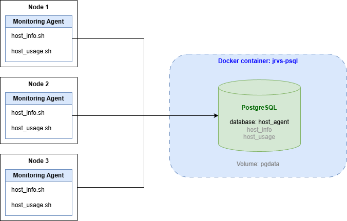

# Linux Cluster Monitoring Agent

# Introduction
This project is a monitoring tool that allows users to track hardware and resource usage in nodes connected to a Linux cluster. The agent tracks static hardware specifications (e.g. CPU count and L2 cache), as well as real time usage data (e.g. free memory and available disk space) and writes them to a central PostgreSQL database, which runs inside a Docker container. 

# Quick Start
```bash
# Create and start a psql instance
./scripts/psql_docker.sh create <db_username> <db_password>
./scripts/psql_docker.sh start

# Create tables host_info and host_usage
psql -h localhost -U postgres -d host_agent -f sql/ddl.sql

# Insert hardware specs data into host_info
./scripts/host_info.sh <psql_host> <psql_port> <db_name> <psql_user> <psql_password>

# Insert usage data into host_usage
./scripts/host_usage.sh <psql_host> <psql_port> <db_name> <psql_user> <psql_password>

# Set up crontab for real time usage monitoring
crontab -e

# Insert the below line to crontab
* * * * * bash <full path to host_usage.sh file>/host_usage.sh <psql_host> <psql_port> <db_name> <psql_user> <psql_password> > /tmp/host_usage.log
```

# Implementation

## Architecture
Every node in the cluster runs the two agent scripts. All of them save the data to a PostgreSQL instance running in Docker.



## Scripts

### psql_docker.sh
Creates, starts and stops the psql instance.
```bash
./scripts/psql_docker.sh create <db_username> <db_password>
./scripts/psql_docker.sh start
./scripts/psql_docker.sh stop
```

### host_info.sh
Collects the node's static hardware specifications and inserts it into the table `host_info`. 
```bash
./scripts/host_info.sh <psql_host> <psql_port> <db_name> <psql_user> <psql_password>
```

### host_usage.sh
Collects the node's current resource usage and inserts it into the table `host_usage`.
```bash
./scripts/host_usage.sh <psql_host> <psql_port> <db_name> <psql_user> <psql_password>
```

### crontab
Runs `host_usage.sh` every minute so usage data is collected in real time
```bash
# edit crontab
crontab -e

# Insert the below line to crontab
* * * * * bash <full path to host_usage.sh file>/host_usage.sh <psql_host> <psql_port> <db_name> <psql_user> <psql_password> > /tmp/host_usage.log

# validate scripts saved in crontab
crontab -l
```

## Database Modeling

### `host_info`
| Column | Type | Constraints | Description | Sample Value |
|---|---|---|---|---|
| `id` | SERIAL | Primary key | Auto-increment id | 1 |
| `hostname` | VARCHAR | Not null, unique | Fully qualified hostname | spry-framework-236416.internal |
| `cpu_number` | INT2 | Not null | Number of CPUs | 1 |
| `cpu_architecture` | VARCHAR | Not null | CPU architecture | x86_64 |
| `cpu_model` | VARCHAR | Not null | CPU model name | Intel(R) Xeon(R) CPU @ 2.30GHz |
| `cpu_mhz` | FLOAT8 | Not null | CPU clock speed in MHz | 2300.000 
| `l2_cache` | INT4 | Not null | L2 cache size in kB | 256 | 601324 |
| `total_mem` | INT4 | | Total memory in kB | 601324 |
| `timestamp` | TIMESTAMP | | Time specs were recorded (UTC) | 2019-05-29 17:49:53 |
 
### `host_usage`
| Column | Type | Constraints | Description | Sample Value |
|---|---|---|---|---|
| `timestamp` | TIMESTAMP | Not null | Time usage data was recorded (UTC) | 2019-05-29 17:49:53 |
| `host_id` | SERIAL | Not null, foreign key to `host_info.id` | The host this row belongs to | 1 |
| `memory_free` | INT4 | Not null | Free memory in MB | 256 |
| `cpu_idle` | INT2 | Not null | Percentage of CPU time idle | 95 |
| `cpu_kernel` | INT2 | Not null | Percentage of CPU time in kernel | 0 |
| `disk_io` | INT4 | Not null | Number of disk I/O | 0 |
| `disk_available` | INT4 | Not null | Available disk space in MB | 31220 |

# Deployment
**GitHub**: Source code was managed with Git using GitFlow branching model. Each feature branch was merged to `develop`, and released to `main` through a pull request.<br>
**crontab**: `host_usage.sh` is scheduled to run every minute.<br>
**Docker**: PostgreSQL database runs in a Docker container.<br>

# Improvements
- Error handling: current scripts handle an incorrect number of arguments, but could be more detailed in missing arguments, or providing usage notes. In addition, scripts could check that each value is not empty before inserting to avoid PostgreSQL errors.
- Clean up: implement an 'expiry' for old data to ensure `host_usage` does not grow too large.
- Dashboard: convert the PostgreSQL data into live charts or dashboards to make data easier to see and interpret patterns. 
